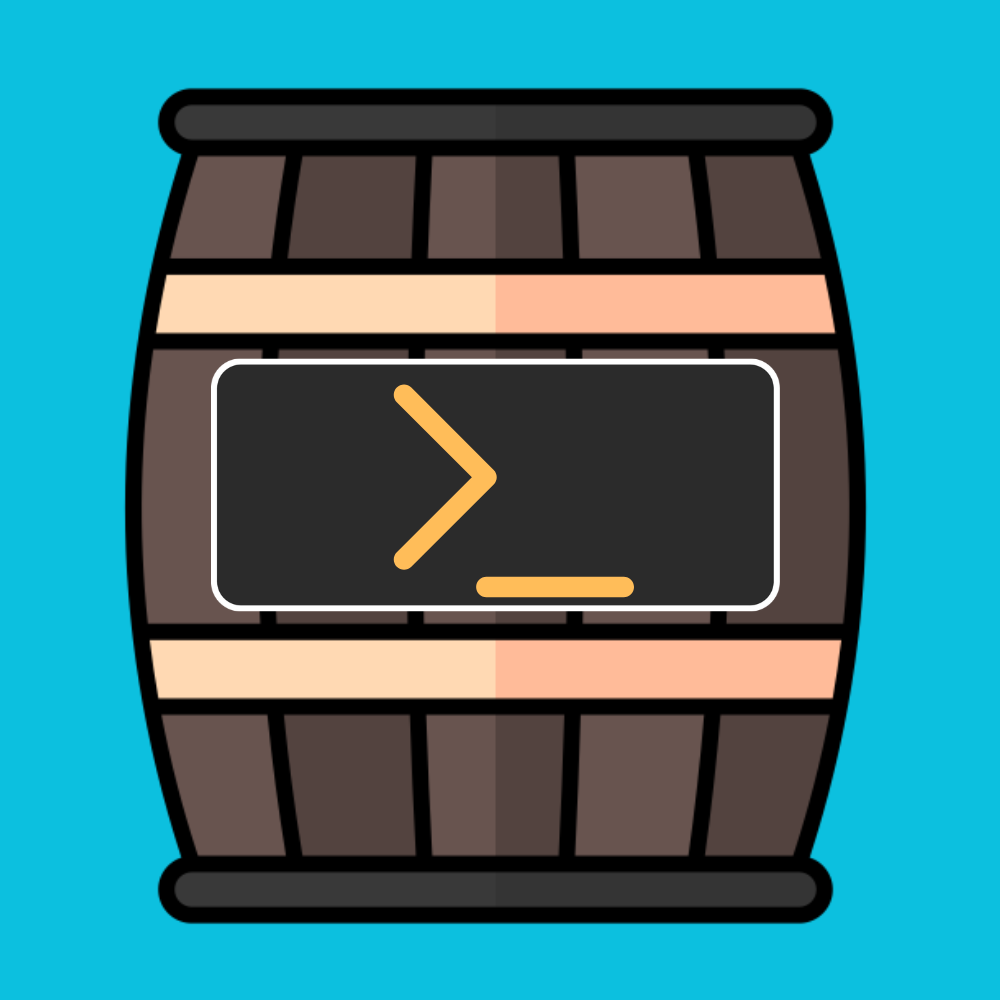

<h1>
  
  BarrelShell
</h1><br>

# BarrelShell

Build and run your own AI agent — a **Barrel** — entirely on your own
hardware. Plain Python + Ollama, no frameworks: personality and memory
live in editable markdown, with Telegram and local web chat, cron-style
scheduled tasks, drop-in skills, and human-in-the-loop approval for
anything risky.

**The Shell** is the platform: self-hosted Ollama, this Python core, and
the settings and skills around it.
**A Barrel** is a running instance — yours, defined entirely by text
files you can read and edit.

Local model inference. No model API keys or subscription. Web searches,
fetches, downloads, and optional browser rendering contact remote sites;
Telegram, if enabled, also carries your chat messages.

---

## Why this exists

Most agent projects hand you a framework and ask you to trust it.
BarrelShell is the opposite: one readable Python file, a handful of
markdown files, and no magic. If you want to know how your agent
thinks, you can read every line of it in an afternoon.

That makes it a working personal assistant *and* a teaching tool.

## What a Barrel can do

- **Chat** over Telegram, or through a local dashboard if you'd rather
  not use Telegram at all
- **Remember** durable facts about you across restarts, and forget them
  when you say so
- **Search the web**, read webpages and text-based PDFs, optionally render
  JavaScript pages, check the weather, do exact math,
  handle timezones, and set one-off reminders
- **Act on its own** on a schedule — morning briefings, weekly reviews,
  a nudge at 3pm — including startup tasks, one-time tasks, and automatic
  cleanup of tasks with explicit expirations
- **Work with files** in a sandboxed workspace, and send images, audio,
  or documents back to you in chat
- **See images** you send it (optional, via any vision-capable local
  model), by describing them into the conversation
- **Report on itself** honestly: uptime, model, token usage, context
  fill, and its own current skill list

## Personality lives in a text file

`identity.md` is the persona. Edit it, send another message, and your
Barrel has changed — no restart. Same for `pulse.md` (its schedule) and
`history.md` (what it knows about you).

```markdown
# Identity

You are Cooper, a personal assistant running locally on your user's own
hardware. No cloud, no telemetry — it's just the two of you.

- Plainspoken and practical. You'd rather give a useful answer than an
  impressive one.
- Honest about uncertainty. If you don't know, say so — never bluff.
```

## Toggle model thinking

In Telegram or local dashboard chat:

- `/think` — toggle thinking requests (first toggle requests OFF).
- `/think on` / `/think off` — explicitly enable or disable thinking.
- `/think status` — show this chat's preference.
- `/think default` — restore Ollama's model default.

The setting is per-chat and resets on restart. It applies from the next turn,
including `/ask` and `/sidebar`; it controls generation, not displaying reasoning
traces. Until you change it, the model's default behavior is preserved. Your
model must support the requested mode—some models cannot disable thinking.
Use a current Ollama server and install the updated `requirements.txt`.

## Skills are drop-in files

Every `.py` file in `skills/` that defines a `SKILL` dict is merged
into your Barrel's toolset at startup. No core edits, and your skills
survive every update:

```python
SKILL = {
    "name": "roll",
    "desc": "Roll dice. Emit <roll>2d6</roll> (NdS format).",
    "handler": roll,   # handler(arg: str, chat_id: int) -> str
}
```

See **[the skill guide](barrelshell-skill-guide.md)** for design
patterns, a full worked example, and the security checklist.

> **Skills are code.** They run with your Barrel's full permissions.
> Read anything you didn't write before dropping it in that folder.

## Safety by containment

Capabilities are grouped into three tiers, and the design principle is
"can't" rather than "shouldn't":

| Tier | Examples | Gate |
|---|---|---|
| Read-only | search, fetch, weather, clock, calc, status | fires freely |
| Contained | workspace files, sending to chat | logged; sandboxed |
| Self-modifying | scheduled tasks | requires human `/approve` |

Your Barrel can *propose* a new scheduled task, but only a command you
type activates it — a code path the model cannot invoke or fake. It
cannot reach its own identity, schedule, or memory files. Web fetches
refuse private network addresses. Every turn, tool call, and error is
logged to `agent_log.jsonl`.

This matters because a Barrel reads untrusted text from the internet.
Containment is what keeps a malicious webpage from becoming permanent
behavior.

## Quick start

Requires Python 3.10+ and [Ollama](https://ollama.com).

### Recommended: guided setup

Install Ollama, then clone this repo and install the Python dependencies:

**Linux / macOS**

```bash
git clone https://github.com/jkries/barrelshell.git
cd barrelshell
python3 -m venv .venv && source .venv/bin/activate
pip install -r requirements.txt
python barrel_v1.py
```

**Windows (PowerShell)**

```powershell
git clone https://github.com/jkries/barrelshell.git
cd barrelshell
py -3 -m venv .venv
.venv\Scripts\python.exe -m pip install -r requirements.txt
.venv\Scripts\python.exe barrel_v1.py
```

Open **http://127.0.0.1:8787/setup**, or choose **Create your Barrel**
on the dashboard. The wizard walks through naming, personality, an actual
Ollama generation test, an isolated test chat, and optional Telegram pairing.
No config copying, launcher editing, or numeric-ID lookup is necessary.
If no model is installed, the wizard shows a pull command; it never starts
a large download automatically.

Local chat works without Telegram. Telegram linking uses an expiring private
pairing link and asks you to confirm the account in the dashboard before it
is authorized. Restart BarrelShell after pairing to activate Telegram.

Progress is saved with **Save & finish later**. Reopen **Setup / Settings**
any time. Existing identities require explicit replacement confirmation and
receive a local backup; unrelated config keys are preserved.

Wizard credentials are stored unencrypted in **`secrets.local.json`**, not
`config.json`; keep that file private. On POSIX it is owner-readable/writable;
on Windows, protect the project folder with your account's filesystem ACLs.
`OLLAMA_HOST`, `TELEGRAM_BOT_TOKEN`, and `TELEGRAM_ALLOWED_IDS` in the environment
override saved settings. For a fresh wizard setup, do not set Telegram variables
in your launcher (even empty ones). See [ONBOARDING.md](ONBOARDING.md) for a
fresh-install test checklist and troubleshooting.

### Manual setup alternative: Linux / macOS

```bash
git clone https://github.com/jkries/barrelshell.git
cd barrelshell

python3 -m venv .venv && source .venv/bin/activate
pip install -r requirements.txt

ollama pull qwen3:8b

cp config.example.json config.json
cp identity.example.md identity.md
cp pulse.example.md pulse.md
```

Create a Telegram bot with [@BotFather](https://t.me/BotFather) and get
your numeric user ID from [@userinfobot](https://t.me/userinfobot). Put
both in a `.env` file:

```ini
TELEGRAM_BOT_TOKEN=123456789:AAF...your-token...
TELEGRAM_ALLOWED_IDS=123456789
```

Then start it:

```bash
set -a; source .env; set +a
python barrel_v1.py
```

### Manual setup alternative: Windows (PowerShell)

```powershell
git clone https://github.com/jkries/barrelshell.git
cd barrelshell

py -3 -m venv .venv
.venv\Scripts\Activate.ps1
# if activation is blocked:
#   Set-ExecutionPolicy -Scope CurrentUser RemoteSigned
pip install -r requirements.txt

ollama pull qwen3:8b

copy config.example.json config.json
copy identity.example.md identity.md
copy pulse.example.md pulse.md
copy run_barrel.example.bat run_barrel.bat
```

Create a Telegram bot with [@BotFather](https://t.me/BotFather) and get
your numeric user ID from [@userinfobot](https://t.me/userinfobot). Open
`run_barrel.bat` in a text editor and fill in both — that file holds
your settings *and* starts your Barrel, restarting it automatically if
it ever crashes:

```bat
set TELEGRAM_BOT_TOKEN=123456789:AAF...your-token...
set TELEGRAM_ALLOWED_IDS=123456789
```

Then double-click `run_barrel.bat`, or run it from the terminal.

> `run_barrel.bat` contains your bot token — it's in `.gitignore` for a
> reason. Never commit it.

---

After manual Telegram setup, message your bot and open
**http://127.0.0.1:8787** for the dashboard. Telegram is optional; omit its
credentials to use only the dashboard.

Full instructions — including Windows, running as a service with crash
recovery, remote Ollama, and model choice by hardware — are in
**[the setup guide](barrelshell-setup.md)**.

## PDF and JavaScript-page reading

Text-based PDF support and main-content HTML extraction are included in
`requirements.txt`. Documents are cached locally with numbered chunks,
PDF page numbers, and explicit partial-read warnings. The agent can read
more chunks or search within a document instead of losing everything
past the first 4,000 characters. Workspace PDFs use the same reader.

Browser rendering is optional and off by default:

```bash
python -m pip install -r requirements-browser.txt
python -m playwright install chromium
```

Set `"fetch_browser_enabled": true` in your existing `config.json` and
restart the bot. Static HTML is tried first; sparse pages trigger browser
fallback. The agent can also explicitly request rendering when a page
has lots of navigation but its real content needs JavaScript.

For upgrade instructions, direct tests without Ollama, configuration,
limits and security details, see **[FETCHING.md](FETCHING.md)**.

Scanned/image-only PDFs still need OCR, which is not included. Browser
rendering does not bypass logins, paywalls, CAPTCHAs or anti-bot controls.

## Managing scheduled tasks

Type `/pulse list` to see task names and expiration dates, then
`/pulse remove NAME` to remove one exact task. `/pulse_remove NAME`
also remains supported. `/pulse cleanup` immediately removes expired
or completed tasks; the scheduler does this automatically too.

In `pulse.md`, an optional `expires:` field directly below `schedule:`
sets a cutoff. A date alone includes that entire local day. For one-time
agent work, use `schedule: @once YYYY-MM-DD HH:MM`; it removes itself
after successful execution. Existing recurring tasks without expiration
are retained. See **[pulse-guide.md](pulse-guide.md)** for examples, approval rules,
retry behavior, and upgrade instructions.

## Hardware

What matters is instruction-following, not encyclopedic knowledge.

| Hardware | Suggested model |
|---|---|
| CPU-only or ≤6 GB VRAM | `qwen3:4b`, `llama3.2:3b` (workable, flaky) |
| 8 GB VRAM | `qwen3:8b`, `llama3.1:8b` — the sweet spot |
| 12–16 GB VRAM | `qwen3:14b`, `gemma3:12b` |
| 24 GB+ / large unified memory | `qwen3:32b` and up |

Smaller models make more protocol mistakes. Below ~4B, expect drift.

## Files

```
barrel_v1.py          the core (one readable file)
dashboard.html        the dashboard UI — edit and refresh to restyle
config.json           your tunables, merged over built-in defaults
identity.md           persona — who your Barrel is
pulse.md              scheduled tasks, in cron syntax (or @reboot)
history.md            durable facts, written by your Barrel
skills/               drop-in skill files
workspace/            the only folder file skills can touch
agent_log.jsonl       every turn, tool call, and error
```

## Status

Early and honest about it: this is a working daily-use agent under
active development, not a polished product. Expect rough edges,
occasional protocol mistakes from smaller models, and breaking changes
between releases. Issues and skill contributions welcome.

## License

MIT — see [LICENSE](LICENSE). Use it, fork it, teach with it.

The BarrelShell name, logo, and barrelshell.com are not covered by that
license.
